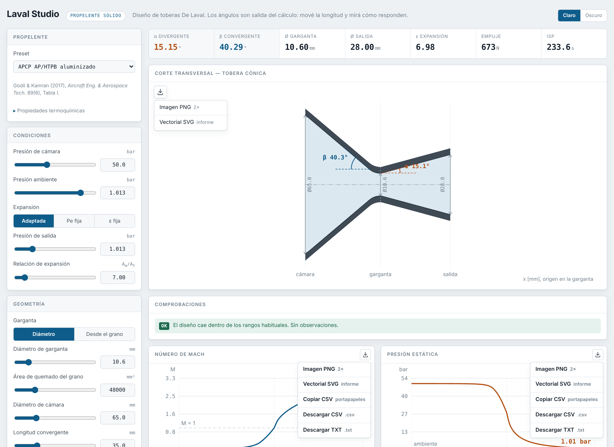

# Laval Studio

Diseño interno de toberas de cohete de propelente sólido, en el navegador y en tiempo real.
Movés un parámetro y se recalculan los ángulos, el contorno, la distribución de Mach y presión,
y las prestaciones.

**[→ Abrir la app](https://marcontini.github.io/laval-studio/)**



---

## El planteamiento

Dada la longitud del divergente, **el ángulo no es un grado de libertad**: queda determinado por
la longitud, el radio de garganta y el radio de salida. Por eso aquí el semiángulo es una *salida*
del cálculo, no una entrada. Si el ángulo que sale no gusta, lo que hay que cambiar es la longitud
o la relación de expansión.

El cálculo resuelve, por bisección, el semiángulo del tramo recto que —partiendo del arco de
acuerdo de garganta de radio `r_arc`— alcanza exactamente `r_e` a la distancia axial `L`:

```
r_e = r_t + r_arc·(1 − cos α) + (L − r_arc·sin α)·tan α
```

Con `r_arc = 0` se reduce al cono ideal `α = atan((r_e − r_t) / L)`. La misma función resuelve el
convergente. La app informa los dos valores, para que se vea cuánto desplaza el arco al cono ideal.

## Qué hace

- **Garganta** por diámetro directo, o resuelta desde el área de quemado del grano por el
  equilibrio de Saint-Robert: `A_t = ρ_p · A_b · a · c* · P_c^(n−1)`, devolviendo el `Kn`.
- **Expansión** adaptada a la presión ambiente, con `P_e` fija o con `ε` impuesta.
- **Contorno** cónico, o campana TOP (parabólica optimizada en empuje) según la construcción de Rao.
- **Prestaciones**: `c*`, `C_F`, empuje, `Isp`, gasto másico, factor de divergencia.
- **Comprobaciones automáticas**: criterio de Summerfield para desprendimiento (`Pe/Pa < 0,4`),
  semiángulos fuera de los rangos habituales (12–18° y 30–45°), `Kn` fuera de 150–400,
  y campana fuera del rango tabulado de Rao.
- **Exportación** por sección: imagen PNG o SVG vectorial con cuadro de rotulación, y los datos de
  las curvas y tablas en CSV o TXT.
- **Configuraciones** guardadas en el navegador, más exportación e importación en `.json`.

## Modelo y sus límites

Flujo isentrópico cuasi-1D, gas ideal de composición congelada, equilibrio en cámara. Es el modelo
estándar de diseño preliminar (Sutton & Biblarz, *Rocket Propulsion Elements*).

**No modela** capa límite, erosión de garganta, flujo bifásico —relevante con APCP aluminizado—,
ni el transitorio de ignición. Sirve para dimensionar y comparar, no para certificar.

## Datos de propelente

| Preset | Origen | Fiabilidad |
|---|---|---|
| APCP AP/HTPB aluminizado | Godil & Kamran (2017), *Aircraft Eng. & Aerospace Tech.* 89(6), Tabla I | Publicado |
| KNSU candy KNO₃/sacarosa 65/35 | Valores tipo Nakka | **Aproximado** |

> **Sobre el preset de candy.** Esos valores no están verificados contra la fuente primaria.
> La velocidad de quemado del candy varía mucho con el proceso de fabricación y con la humedad.
> Caracterizá tu propio lote antes de usarlos para algo real. Todas las propiedades
> termoquímicas son editables en la app.

## Uso local

Es un único archivo HTML sin dependencias ni servidor. Descargá `index.html` y abrilo con doble clic.
Funciona sin conexión; lo único que carga de fuera son las tipografías, y hay respaldo del sistema
si no están disponibles.

```bash
git clone https://github.com/marcontini/laval-studio.git
cd laval-studio
# abrí index.html en el navegador, o:
python3 -m http.server 8000   # luego http://localhost:8000
```

## Versión de línea de comandos

`cli/laval-studio-cli.py` hace los mismos cálculos desde la terminal y genera la figura con matplotlib.
Útil para barridos y para automatizar.

```bash
pip install numpy matplotlib
python cli/laval-studio-cli.py                            # ejemplo APCP clase M
python cli/laval-studio-cli.py --preset knsu --pc 35
python cli/laval-studio-cli.py --contour bell --l-div 26
python cli/laval-studio-cli.py --ab 48000 --pc 50         # garganta desde el grano
python cli/laval-studio-cli.py --csv contorno.csv --no-plot
python cli/laval-studio-cli.py --help
```

La física de JavaScript y la de Python se comprobaron una contra otra: coinciden hasta el último
dígito en los casos de prueba.

## Validación

El caso por defecto (APCP, Pc = 50 bar, Ø garganta 10,6 mm) da **673 N** de empuje frente a los
656 N del Aerotech M650W tomado como referencia, con `c* = 1580 m/s` y `ε = 6,98`. Eso es un
contraste de orden de magnitud contra un motor comercial conocido, no una validación experimental.

Si encontrás una discrepancia contra tu bibliografía o contra datos de banco, abrí un *issue*:
las correcciones con fuente se aceptan.

## Atribución

Ver [ATRIBUCIONES.md](ATRIBUCIONES.md) para el detalle del origen de cada parte.

## Licencia

MIT — ver [LICENSE](LICENSE). Podés usarlo, modificarlo y distribuirlo, incluso comercialmente,
conservando el aviso de copyright.
